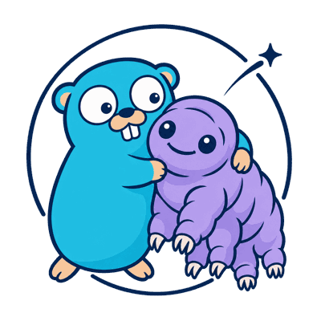

<p align="center">
  
</p>

<h1 align="center">temporal-controller</h1>

<p align="center">
  Temporal namespaces as Kubernetes resources. Declare one in YAML, and the controller makes Temporal match it.
</p>

<p align="center">
  <a href="https://github.com/cujarrett/temporal-controller/actions/workflows/ci.yml"></a>
</p>

```yaml
apiVersion: temporal.local.lab/v1alpha1
kind: TemporalNamespace
metadata:
  name: foo
spec:
  retention: 72h                 # required, history kept for closed workflows
  description: Workflows for foo # optional, shown in the Temporal UI
```

The Temporal namespace takes the object's name. `Ready` turns `True` once Temporal matches the spec.

## What it does

- **Create:** registers the namespace and records which object owns it.
- **Drift:** every 5 minutes, puts retention and description back to the spec.
- **Conflict:** leaves a namespace another object owns, or one made outside the controller, alone. `Ready` turns `False` with reason `Conflict`.
- **Delete:** removes the namespace with the object, but only if that object owns it.

## Run it

| Flag | Default | Sets |
|---|---|---|
| `--temporal-address` | `localhost:7233` | The Temporal frontend, as `host:port` |

```bash
make install   # apply the CRD to your current cluster
make run       # run the controller locally against it
```

## Develop

```bash
make generate manifests   # after editing api/
make test                 # unit and envtest suites, with a fake Temporal
make lint
```

To also test against a real server, run `temporal server start-dev` and set `TEMPORAL_ADDRESS=localhost:7233`.

---

<sub>Go gopher by Renée French, CC BY 4.0. Ziggy is Temporal's mascot.</sub>
